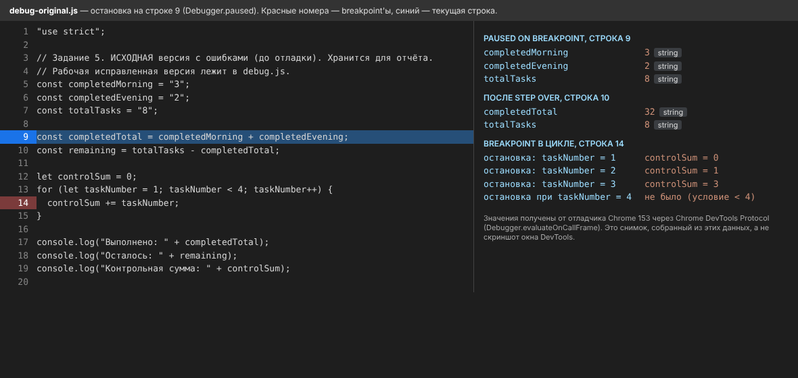

# Практическая работа № 1. Подготовка окружения и первые программы на JavaScript

## 1. Автор, группа, вариант

| Поле | Значение |
|---|---|
| Студент | Ахметгалиев Арслан Альбертович |
| Группа | ЭФБО-17-25 |
| Номер в журнале N | 2 |
| Вариант | 2, так как `((N - 1) % 8) + 1 = ((2 - 1) % 8) + 1 = 2` |
| Данные варианта | `totalTasks = 15`, `completedTasks = 0`, `dailyLimit = 4` |
| Дополнительное задание | вариант Б, `plan-week.js` |

## 2. Окружение

| Что | Версия (фактический вывод) |
|---|---|
| Операционная система | Ubuntu 24.04.5 LTS, Linux x64 |
| Node.js (`node --version`) | v22.23.4 |
| npm (`npm --version`) | 10.9.9 |
| Git (`git --version`) | 2.43.0 |
| Браузер | Google Chrome for Testing 153.0.8010.12 |

В методичке указана учебная ветка Node.js 24 LTS. У меня установлена v22.23.4. В коде нет ничего, что зависит от версии 24: только `const`/`let`, циклы, `Number`, `Math.min` и шаблонные строки.

## 3. Запуск

Из корня репозитория:

```bash
node practice-01/js/hello.js
node practice-01/js/types.js
node practice-01/js/progress.js
node practice-01/js/plan.js
node practice-01/js/debug.js
node practice-01/js/plan-week.js        # расширение
node practice-01/tools/run-cases.mjs    # прогон всех таблиц проверок из пунктов 6 и 8
```

Файл `js/debug-original.js` хранит исходную версию `debug.js` с ошибками, она нужна для раздела 7.

В браузере: открыть `practice-01/index.html` (двойным щелчком или через Live Server), нажать F12 и открыть вкладку Console. Подключён только один файл, по умолчанию `./js/hello.js`. Чтобы посмотреть другое задание, меняю `src` у тега `<script>` и перезагружаю страницу. Подключать несколько файлов сразу нельзя: у них совпадают имена `const` верхнего уровня (`totalTasks` и другие), будет ошибка повторного объявления.

Вывод всех файлов в Chrome сохранён в `protocol-browser.txt`. Вывод таблиц проверок из Node сохранён в `protocol-cases.txt`.

## 4. Задание 1. `hello.js`

Файл начинается с `"use strict";`, содержит константы `studentName`, `groupName`, `practiceNumber` и выводит данные через `console.log`. Последняя строка выводит `typeof document`.

| Среда | Как запускал | Где виден вывод | Последняя строка |
|---|---|---|---|
| Node.js | `node practice-01/js/hello.js` | в терминале | `typeof document: undefined` |
| Браузер (Chrome) | `index.html`, `defer`-скрипт | вкладка Console в DevTools | `typeof document: object` |

Первые четыре строки в обеих средах одинаковые. Различие только в последней: в браузере есть объект `document` (страница), в Node.js его нет, потому что там нет страницы. Это и есть главное отличие двух сред. Без имени файла команда `node` запускает интерактивный режим, а не программу.

## 5. Задание 2. `types.js`

Прогноз записан до первого запуска. Значения в столбце «Факт» одинаковы в Node.js и в Chrome (см. `protocol-browser.txt`).

| № | Выражение | Прогноз | Факт (значение) | Тип результата | Объяснение |
|---:|---|---|---|---|---|
| 1 | `"8" + 2` | `"82"`, string | `82` | string | Если один из операндов строка, `+` склеивает строки, число 2 превращается в `"2"`. |
| 2 | `"8" - 2` | `6`, number | `6` | number | У `-` нет строкового смысла, строка `"8"` переводится в число. |
| 3 | `Number("8") + 2` | `10`, number | `10` | number | Преобразование сделано явно, затем обычное сложение. |
| 4 | `"12" > "3"` | `false`, boolean | `false` | boolean | Обе строки, сравнение посимвольное: `"1"` меньше `"3"`, поэтому `"12"` меньше `"3"`. |
| 5 | `12 === "12"` | `false`, boolean | `false` | boolean | `===` не приводит типы: number и string разные. |
| 6 | `Number("")` | `0`, number | `0` | number | Пустая строка при преобразовании в число даёт 0. |
| 7 | `Number("text")` | `NaN`, number | `NaN` | number | Строку нельзя разобрать как число, получается NaN. |
| 8 | `Boolean("false")` | `true`, boolean | `true` | boolean | Любая непустая строка истинна, неважно, что в ней написано. |
| 9 | `typeof null` | `"object"` | `object` | string | Историческая особенность языка: `null` не объект, но `typeof` возвращает `"object"`. |
| 10 | `typeof NaN` | `"number"` | `number` | string | NaN относится к числовому типу, это «не число» внутри типа number. |

В строках 9 и 10 надо различать две вещи: значение выражения `typeof ...` (строка `"object"` или `"number"`) и тип этого результата (всегда string, потому что `typeof` возвращает строку).

## 6. Задания 3 и 4

### Задание 3. `progress.js`

Данные варианта 2 заданы в файле: `totalTasks = 15`, `completedTasks = 0`. Вывод для них:

```text
Всего задач: 15
Выполнено: 0
Осталось: 15
Прогресс: 0.0%
Статус: Не начато
```

Проверки (строки 1–10 взяты из методички, 11–17 добавлены мной: свой вариант, граница 1000, `Infinity`, `null`, `undefined`, `0` и `1`). Значения подставляет `tools/run-cases.mjs`: он делает временную копию файла, меняет строки `const totalTasks = ...;`, запускает её через `node` и сравнивает вывод с ожиданием. Ожидания записаны в скрипте заранее, фактический вывод скрипт не подгоняет.

| № | totalTasks | completedTasks | Ожидание | Фактический вывод | Итог |
|---:|---|---|---|---|---|
| 1 | `12` | `5` | Осталось 7; 41.7%; «В работе» | Всего задач: 12<br>Выполнено: 5<br>Осталось: 7<br>Прогресс: 41.7%<br>Статус: В работе | совпало |
| 2 | `0` | `0` | «Задач пока нет», без процента | Задач пока нет | совпало |
| 3 | `5` | `0` | Осталось 5; 0.0%; «Не начато» | Всего задач: 5<br>Выполнено: 0<br>Осталось: 5<br>Прогресс: 0.0%<br>Статус: Не начато | совпало |
| 4 | `5` | `5` | Осталось 0; 100.0%; «Завершено» | Всего задач: 5<br>Выполнено: 5<br>Осталось: 0<br>Прогресс: 100.0%<br>Статус: Завершено | совпало |
| 5 | `5` | `6` | Ошибка: выполнено больше, чем задач | Ошибка: выполнено больше, чем задач | совпало |
| 6 | `-1` | `0` | Ошибка: отрицательное количество | Ошибка: отрицательное количество | совпало |
| 7 | `5` | `2.5` | Ошибка: дробное значение | Ошибка: дробное значение, нужны целые числа | совпало |
| 8 | `"5"` | `2` | Ошибка: передана строка | Ошибка: totalTasks — передана строка | совпало |
| 9 | `1001` | `0` | Ошибка: превышена граница | Ошибка: превышена граница, totalTasks не больше 1000 | совпало |
| 10 | `NaN` | `0` | Ошибка: недопустимое число | Ошибка: недопустимое число (NaN или Infinity) | совпало |
| 11 | `15` | `0` | Вариант 2: 0.0%; «Не начато» | Всего задач: 15<br>Выполнено: 0<br>Осталось: 15<br>Прогресс: 0.0%<br>Статус: Не начато | совпало |
| 12 | `1000` | `1` | Граница 1000 допустима; 0.1%; «В работе» | Всего задач: 1000<br>Выполнено: 1<br>Осталось: 999<br>Прогресс: 0.1%<br>Статус: В работе | совпало |
| 13 | `1000` | `1000` | Граница 1000 допустима; 100.0% | Всего задач: 1000<br>Выполнено: 1000<br>Осталось: 0<br>Прогресс: 100.0%<br>Статус: Завершено | совпало |
| 14 | `Infinity` | `0` | Ошибка: недопустимое число | Ошибка: недопустимое число (NaN или Infinity) | совпало |
| 15 | `5` | `null` | Ошибка: значения должны быть числами | Ошибка: значения должны быть числами | совпало |
| 16 | `5` | `undefined` | Ошибка: значения должны быть числами | Ошибка: значения должны быть числами | совпало |
| 17 | `0` | `1` | Ошибка: выполнено больше, чем задач | Ошибка: выполнено больше, чем задач | совпало |

Итого: 17 проверок, все 17 совпали.

Статус определяется по исходным числам, а не по проценту. Пример: 1 задача из 1000 это 0.1%, но статус «В работе», а не «Не начато» (строка 12).

### Задание 4. `plan.js`

Данные варианта 2: `totalTasks = 15`, `completedTasks = 0`, `dailyLimit = 4`.

```text
Осталось задач: 15
День 1: выполнено 4, осталось 11
День 2: выполнено 4, осталось 7
День 3: выполнено 4, осталось 3
День 4: выполнено 3, осталось 0
Потребуется дней: 4
```

Используется цикл `while`; в последний день количество ограничено через `Math.min(dailyLimit, remaining)`, поэтому в день 4 выполнено 3, а не 4. Массивов и своих функций в `plan.js` нет. Значение `dailyLimit` проверяется всегда, в том числе когда задач не осталось (строка 13).

| № | totalTasks | completedTasks | dailyLimit | Ожидание | Фактический вывод | Итог |
|---:|---|---|---|---|---|---|
| 1 | `12` | `5` | `3` | 3 дня, в последний день 1 задача | Осталось задач: 7<br>День 1: выполнено 3, осталось 4<br>День 2: выполнено 3, осталось 1<br>День 3: выполнено 1, осталось 0<br>Потребуется дней: 3 | совпало |
| 2 | `10` | `4` | `3` | 2 дня по 3 | Осталось задач: 6<br>День 1: выполнено 3, осталось 3<br>День 2: выполнено 3, осталось 0<br>Потребуется дней: 2 | совпало |
| 3 | `5` | `3` | `10` | 1 день, 2 задачи | Осталось задач: 2<br>День 1: выполнено 2, осталось 0<br>Потребуется дней: 1 | совпало |
| 4 | `5` | `5` | `2` | 0 дней | Все задачи уже выполнены<br>Потребуется дней: 0 | совпало |
| 5 | `0` | `0` | `2` | 0 дней | Все задачи уже выполнены<br>Потребуется дней: 0 | совпало |
| 6 | `5` | `2` | `0` | ошибка | Ошибка: dailyLimit должен быть от 1 до 1000 | совпало |
| 7 | `5` | `2` | `1.5` | ошибка (дробь) | Ошибка: дробное значение, нужны целые числа | совпало |
| 8 | `5` | `6` | `2` | ошибка | Ошибка: выполнено больше, чем задач | совпало |
| 9 | `5` | `2` | `"2"` | ошибка (строка) | Ошибка: dailyLimit — передана строка | совпало |
| 10 | `5` | `2` | `1001` | ошибка (граница) | Ошибка: dailyLimit должен быть от 1 до 1000 | совпало |
| 11 | `15` | `0` | `4` | Вариант 2: 4 дня (4+4+4+3) | Осталось задач: 15<br>День 1: выполнено 4, осталось 11<br>День 2: выполнено 4, осталось 7<br>День 3: выполнено 4, осталось 3<br>День 4: выполнено 3, осталось 0<br>Потребуется дней: 4 | совпало |
| 12 | `8` | `0` | `4` | ровное деление: 2 дня по 4 | Осталось задач: 8<br>День 1: выполнено 4, осталось 4<br>День 2: выполнено 4, осталось 0<br>Потребуется дней: 2 | совпало |
| 13 | `3` | `3` | `0` | ошибка: dailyLimit проверяется даже без остатка | Ошибка: dailyLimit должен быть от 1 до 1000 | совпало |
| 14 | `3` | `0` | `1` | лимит 1: 3 дня по 1 | Осталось задач: 3<br>День 1: выполнено 1, осталось 2<br>День 2: выполнено 1, осталось 1<br>День 3: выполнено 1, осталось 0<br>Потребуется дней: 3 | совпало |
| 15 | `5` | `2` | `1000` | граница лимита допустима: 1 день | Осталось задач: 3<br>День 1: выполнено 3, осталось 0<br>Потребуется дней: 1 | совпало |

Итого: 15 проверок, все 15 совпали.

## 7. Отладка (`debug.js`)

**Исходная версия** (`js/debug-original.js`). Вывод Node.js и Chrome одинаковый:

```text
Выполнено: 32
Осталось: -24
Контрольная сумма: 6
```

Программа завершилась без исключений, но результат неверный: правильные значения 5, 3 и 10. Отсутствие ошибки в консоли не доказывает, что программа верна.

**Что делал в отладчике Chrome.** Подключил `debug-original.js` в `index.html`, поставил breakpoint на строку 9 (`const completedTotal = completedMorning + completedEvening;`), перезагрузил страницу. Значения при остановке:

| Выражение | Значение | Тип |
|---|---|---|
| `completedMorning` | `"3"` | string |
| `completedEvening` | `"2"` | string |
| `totalTasks` | `"8"` | string |

После Step over: `completedTotal = "32"`, тип string. Дальше `totalTasks - completedTotal` вычитает `"32"` из `"8"`, и JavaScript молча переводит обе строки в числа: получилось `-24`. Второй breakpoint стоял в теле цикла (строка 14). Остановки были при `taskNumber = 1, 2, 3` и `controlSum = 0, 1, 3`. Остановки при `taskNumber = 4` не было: цикл завершился раньше.

| № | Наблюдение | Причина | Исправление | Результат |
|---:|---|---|---|---|
| 1 | `Выполнено: 32` | `"3" + "2"`: обе строки, `+` склеивает их | `Number(completedMorning) + Number(completedEvening)` | `5` |
| 2 | `Осталось: -24` | `"8" - "32"`: вычитание из строк работает через скрытое приведение типов, а `"32"` уже было ошибкой из п. 1 | `Number(totalTasks) - completedTotal`, оба операнда явно числа | `3` |
| 3 | `Контрольная сумма: 6` | условие `taskNumber < 4` не включает число 4, сумма 1+2+3 | условие `taskNumber <= 4` | `10` |

Исправление выполнено без подстановки констант `5`, `3` и `10`: значения по-прежнему вычисляются из исходных данных.

**Исправленный вывод** (`js/debug.js`, Node.js и Chrome совпали):

```text
Выполнено: 5
Осталось: 3
Контрольная сумма: 10
```

Снимок остановки: `screenshots/debug-breakpoint.png`.



Примечание: этот снимок собран из значений, которые вернул отладчик Chrome через Chrome DevTools Protocol (`Debugger.paused` и `evaluateOnCallFrame`). Это не скриншот окна DevTools. Значения, строки остановки и номера строк реальные.

## 8. Расширение: `plan-week.js` (вариант Б)

Правила: первый день понедельник, суббота и воскресенье выходные. В выходные задачи не выполняются, `dailyLimit` действует только в рабочие дни. Выводится расписание по календарным дням, число рабочих дней с задачами и число календарных дней. Выходные после выполнения последней задачи не добавляются: цикл `while` заканчивается, как только остаток стал 0. Номер дня недели считается как `(calendarDays - 1) % 7`, значения 5 и 6 это суббота и воскресенье.

Для варианта 2 (15 / 0 / 4) выходных в расписании нет, все задачи укладываются в понедельник-четверг:

```text
Осталось задач: 15
День 1 (пн): выполнено 4, осталось 11
День 2 (вт): выполнено 4, осталось 7
День 3 (ср): выполнено 4, осталось 3
День 4 (чт): выполнено 3, осталось 0
Рабочих дней с задачами: 4
Календарных дней: 4
```

Контрольный случай из методички `6 / 0 / 1` даёт 6 рабочих и 8 календарных дней (после пятницы идут суббота и воскресенье, шестая задача в понедельник). Мои проверки (ожидания посчитаны вручную до запуска):

| № | totalTasks | completedTasks | dailyLimit | Ожидание | Фактический вывод | Итог |
|---:|---|---|---|---|---|---|
| 1 | `6` | `0` | `1` | контрольный случай: 6 рабочих, 8 календарных | Осталось задач: 6<br>День 1 (пн): выполнено 1, осталось 5<br>День 2 (вт): выполнено 1, осталось 4<br>День 3 (ср): выполнено 1, осталось 3<br>День 4 (чт): выполнено 1, осталось 2<br>День 5 (пт): выполнено 1, осталось 1<br>День 6 (сб): выходной<br>День 7 (вс): выходной<br>День 8 (пн): выполнено 1, осталось 0<br>Рабочих дней с задачами: 6<br>Календарных дней: 8 | совпало |
| 2 | `15` | `0` | `4` | вариант 2: 4 рабочих, 4 календарных (выходных нет) | Осталось задач: 15<br>День 1 (пн): выполнено 4, осталось 11<br>День 2 (вт): выполнено 4, осталось 7<br>День 3 (ср): выполнено 4, осталось 3<br>День 4 (чт): выполнено 3, осталось 0<br>Рабочих дней с задачами: 4<br>Календарных дней: 4 | совпало |
| 3 | `12` | `5` | `3` | 3 рабочих, 3 календарных | Осталось задач: 7<br>День 1 (пн): выполнено 3, осталось 4<br>День 2 (вт): выполнено 3, осталось 1<br>День 3 (ср): выполнено 1, осталось 0<br>Рабочих дней с задачами: 3<br>Календарных дней: 3 | совпало |
| 4 | `5` | `0` | `1` | ровно рабочая неделя: 5 и 5, выходные не добавляются | Осталось задач: 5<br>День 1 (пн): выполнено 1, осталось 4<br>День 2 (вт): выполнено 1, осталось 3<br>День 3 (ср): выполнено 1, осталось 2<br>День 4 (чт): выполнено 1, осталось 1<br>День 5 (пт): выполнено 1, осталось 0<br>Рабочих дней с задачами: 5<br>Календарных дней: 5 | совпало |
| 5 | `7` | `0` | `1` | 7 рабочих, 9 календарных | Осталось задач: 7<br>День 1 (пн): выполнено 1, осталось 6<br>День 2 (вт): выполнено 1, осталось 5<br>День 3 (ср): выполнено 1, осталось 4<br>День 4 (чт): выполнено 1, осталось 3<br>День 5 (пт): выполнено 1, осталось 2<br>День 6 (сб): выходной<br>День 7 (вс): выходной<br>День 8 (пн): выполнено 1, осталось 1<br>День 9 (вт): выполнено 1, осталось 0<br>Рабочих дней с задачами: 7<br>Календарных дней: 9 | совпало |
| 6 | `10` | `0` | `1` | 10 рабочих, 12 календарных | Осталось задач: 10<br>День 1 (пн): выполнено 1, осталось 9<br>День 2 (вт): выполнено 1, осталось 8<br>День 3 (ср): выполнено 1, осталось 7<br>День 4 (чт): выполнено 1, осталось 6<br>День 5 (пт): выполнено 1, осталось 5<br>День 6 (сб): выходной<br>День 7 (вс): выходной<br>День 8 (пн): выполнено 1, осталось 4<br>День 9 (вт): выполнено 1, осталось 3<br>День 10 (ср): выполнено 1, осталось 2<br>День 11 (чт): выполнено 1, осталось 1<br>День 12 (пт): выполнено 1, осталось 0<br>Рабочих дней с задачами: 10<br>Календарных дней: 12 | совпало |
| 7 | `5` | `5` | `2` | задач нет: 0 и 0 | Все задачи уже выполнены<br>Рабочих дней с задачами: 0<br>Календарных дней: 0 | совпало |
| 8 | `5` | `2` | `0` | ошибка | Ошибка: dailyLimit должен быть от 1 до 1000 | совпало |

Итого: 8 проверок, все 8 совпали.

## 9. Вывод

Освоил запуск JavaScript в двух средах и разницу между ними: в браузере есть `document`, в Node.js нет. Проверил на практике, как работает приведение типов (конкатенация против вычитания, `Number("")`, `NaN`, `typeof null`) и почему нужно сравнивать через `===`. Научился проверять входные данные до расчёта и отдельно разбирать обычные, граничные и некорректные значения. Работа с DevTools: breakpoint, Step over, просмотр значений и типов. По ней нашёл три ошибки в `debug.js`, хотя программа не падала.

Для заданий 3 и 4 сделал скрипт `tools/run-cases.mjs`, который подставляет данные и сверяет вывод с заранее записанными ожиданиями. Я проверил и сам скрипт: когда в копии `progress.js` поменял `toFixed(1)` на `toFixed(2)`, а в `plan.js` убрал `Math.min`, скрипт показал 10 несовпадений из 40, то есть сравнение работает.

Расширение: в `plan-week.js` реализовано расписание с выходными; контрольный случай 6/0/1 даёт 6 и 8.

## 10. Чек-лист перед сдачей

- [x] Файлы запускаются в Node.js и в браузере (`protocol-browser.txt`).
- [x] В заданиях 3 и 4 данные варианта 2, проверены на других данных.
- [x] Ошибки в `debug.js` исправлены, исходная версия сохранена в `debug-original.js`.
- [x] Версии в разделе 2 фактические.
- [x] Изображение подключено по относительному пути.
- [x] В репозитории нет паролей и токенов.
