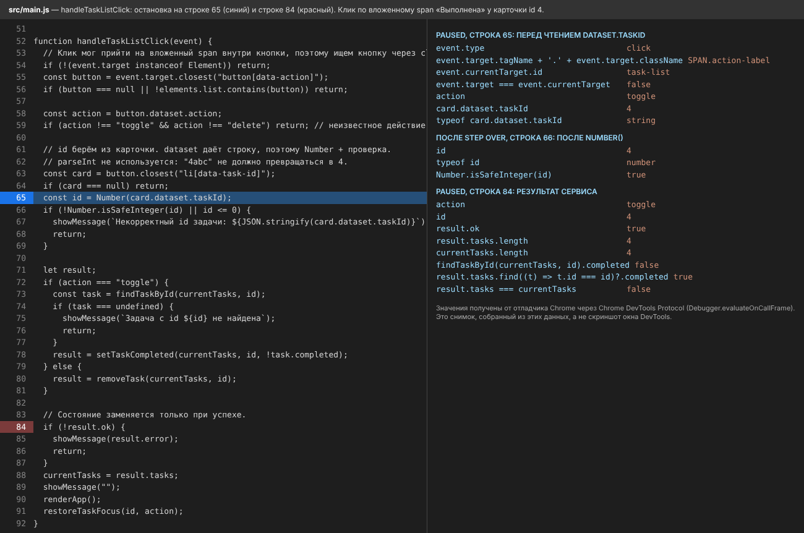
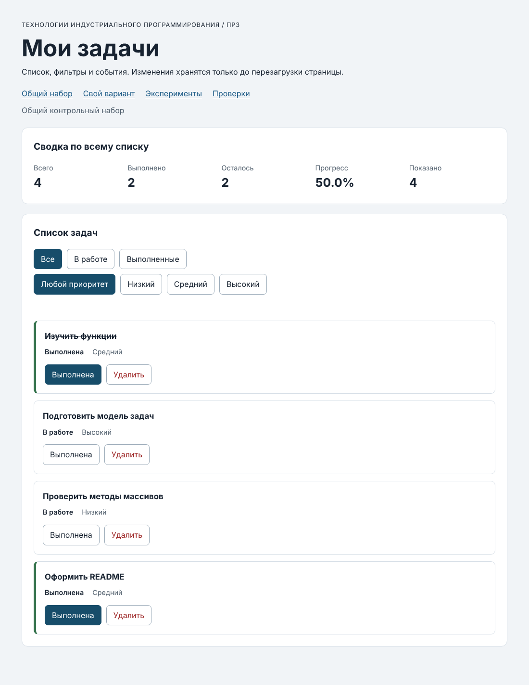
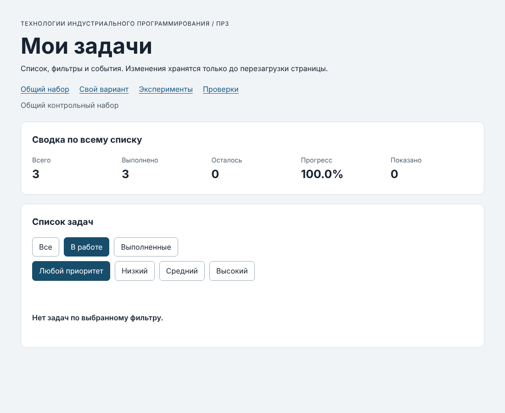
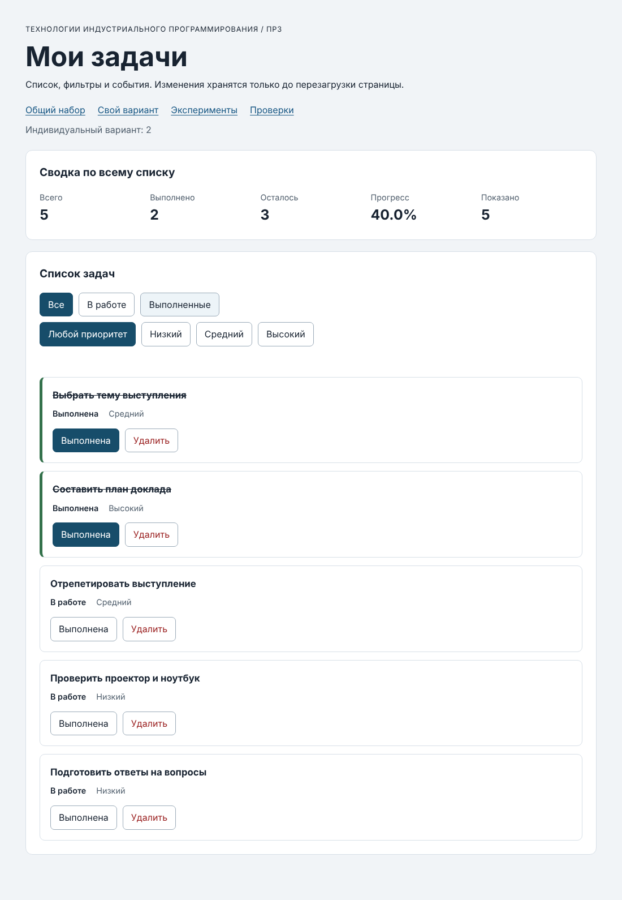

# Практическая работа № 3. Работа с DOM и событиями

## Данные работы

| Поле | Значение |
|---|---|
| Имя | Ахметгалиев Арслан Альбертович |
| Группа | ЭФБО-17-25 |
| Вариант из ПР2 | 2 («Подготовка выступления», номер в журнале N = 2) |
| Node.js | v22.23.4 |
| Браузер | Google Chrome for Testing 153.0.8010.12 |
| Операционная система | Ubuntu 24.04.5 LTS, Linux x64 |

Методичка рассчитана на Node.js 24, у меня v22.23.4: сервер `tools/serve.mjs` и проверки используют только встроенные модули.

## Запуск

Рабочая папка: `practice-03` внутри личного репозитория.

```bash
npm run check:service
npm start
```

Устанавливать зависимости через `npm install` не требуется. Для PowerShell при блокировке `npm.ps1` доступны `npm.cmd` и прямые команды `node` (`node tools/serve.mjs`).

```text
http://127.0.0.1:5503/
http://127.0.0.1:5503/index.html?dataset=variant
http://127.0.0.1:5503/examples/dom-events.html
http://127.0.0.1:5503/checks.html
http://127.0.0.1:5503/checks-own.html
```

Страница `checks-own.html` моя: на ней мои собственные проверки (раздел «Собственные проверки»). Остановка сервера: `Ctrl+C`. Порт стандартный, 5503.

Страницы открывались в Chrome автоматически (Playwright), так как в рабочей среде нет окна браузера; те же шаги воспроизводятся вручную по адресам выше. Вся информация о результатах ниже получена этими запусками.

## Что перенесено из ПР2

`src/task-service.js` и `src/data.js` скопированы из моего `practice-02` без изменений. Проверка после переноса: `npm run check:service` показывает «Проверок пройдено: 35; не пройдено: 0.» (вывод ниже). `main.js` из ПР2 не переносился. `task-service.js` не обращается к `document`.

Что изменено в готовых файлах комплекта, помимо заглушек:
- `index.html`: добавлена группа кнопок `#priority-filters` (для расширения), группа `#task-filters` не тронута;
- `styles.css`: добавлено правило отступа для `#priority-filters`;
- `tools/serve.mjs`: в список разрешённых файлов добавлены `checks-own.html` и `checks/own.checks.js`, больше ничего.

## Эксперименты

Прогноз записан до запуска. Результат взят из Console страницы `examples/dom-events.html`.

| № | До запуска: прогноз | После запуска: результат | Объяснение |
|---:|---|---|---|
| 1. Отсутствующий элемент и коллекция | `querySelector("#absent")` даст `null`, а `querySelectorAll(".absent")` не `null`, а пустую коллекцию длиной 0 | `Отсутствующий элемент: null`, `Пустая коллекция: 0` | `querySelector` возвращает один элемент или `null`, поэтому перед использованием нужна проверка. `querySelectorAll` всегда возвращает коллекцию, пусть и пустую. |
| 2. dataset и числовой id | `dataset.taskId` это строка `"23"`, `Number(...)` даёт число 23 | `dataset.taskId: 23 string`, `Числовой id: 23` | Атрибуты HTML всегда строки. Для сравнения с `task.id` (число) нужно явное преобразование через `Number` с проверкой. |
| 3. Статический NodeList | После двух нажатий старая коллекция `initialItems` останется длиной 1, новый `querySelectorAll` покажет 2, затем 3 | `Старый NodeList: 1`, `Новый querySelectorAll: 2`; после второго нажатия `Старый NodeList: 1`, `Новый querySelectorAll: 3`; в DOM 3 элемента `li` | `querySelectorAll` возвращает статичный снимок на момент вызова. Чтобы увидеть новые элементы, поиск надо выполнить заново. |
| 4. Строка с HTML-разметкой | Заголовок покажет текст `<strong>Это текст, а не HTML</strong>` буквально, новый элемент `strong` не появится | Заголовок: `<strong>Это текст, а не HTML</strong>`, дочерних элементов внутри заголовка: 0 | `textContent` записывает строку как текст, а не разбирает её как разметку. Поэтому названия задач выводятся через `textContent`, а не `innerHTML`: иначе введённая пользователем разметка стала бы частью страницы. |
| 5. Распространение события | Нажатие по вложенному `span`: сначала обработчик карточки на захвате (фаза 1), затем обработчик кнопки, затем обработчик карточки на всплытии. `target` везде `lab-label`. Для кнопки фаза будет 3, а не 2, потому что целью является span, а не кнопка | 1. `phase=1; target=lab-label; currentTarget=lab-card`; 2. `phase=3; target=lab-label; currentTarget=lab-button`; 3. `phase=3; target=lab-label; currentTarget=lab-card` | Событие идёт сверху вниз (захват), доходит до цели и поднимается обратно (всплытие). Фаза 2 бывает только у самой цели. `target` это элемент, по которому реально нажали (span), `currentTarget` это элемент, чей обработчик сейчас выполняется. Поэтому контейнер получает нажатие по вложенному элементу: оно всплывает вверх. На этом основано делегирование. |

## Организация кода

| Файл | Что делает |
|---|---|
| `src/data.js` | данные: `demoTasks`, `variantNumber`, `variantTasks` (из ПР2) |
| `src/task-service.js` | логика ПР2: поиск, статистика, `addTask`, `setTaskCompleted`, `removeTask` и др.; никакого DOM |
| `src/task-selectors.js` | `getVisibleTasks(tasks, filter)` для `all`/`pending`/`completed`; расширение: `filterByPriority` |
| `src/task-view.js` | создание DOM: `createTaskElement`, `renderTaskList`, `renderSummary`, `renderEmptyState`; состояние не меняет и обработчики не навешивает |
| `src/main.js` | состояние (`currentTasks`, `currentFilter`, `currentPriority`), `renderApp`, обработчики `handleTaskListClick`, `handleFilterClick`, `handlePriorityFilterClick`, однократные подписки |

- Полный список задач хранится в `currentTasks` (только в `main.js`), активный фильтр в `currentFilter`. Фильтрация не перезаписывает `currentTasks`: `getVisibleTasks` возвращает новый массив.
- Событие обрабатывается в `main.js`: один обработчик на `ul#task-list` и один на `#task-filters` (делегирование). Подписки ставятся один раз при загрузке, а не в `renderApp`, потому что карточки пересоздаются при каждой перерисовке.
- Сводка вычисляется в `task-view.js` через `getTaskStats(currentTasks)` по всему списку, «Показано» это длина отфильтрованного списка.
- Название выводится через `textContent`, `innerHTML` нигде не используется. Id берётся через `Number` с проверкой `Number.isSafeInteger`, `parseInt` не применяется.
- Состояние заменяется только при `result.ok === true`; при отказе текст ошибки выводится в `#operation-message`.

## Общий сценарий

Ожидания: раздел 5 методички (таблица шагов 0–7). Фактические значения прочитаны со страницы после настоящих кликов по подписям кнопок (клик приходит на вложенный `span`).

| Шаг | Действие | Видимые id | Всего | Выполнено | Осталось | Прогресс | Показано | Сообщение | Совпало с ожиданием |
|---:|---|---|---|---|---|---|---|---|---|
| 0 | Исходное состояние, «Все» | 1, 4, 7, 10 | 4 | 2 | 2 | 50.0% | 4 | — | да |
| 1 | «В работе» | 4, 7 | 4 | 2 | 2 | 50.0% | 2 | — | да |
| 2 | Отметить 4 выполненной | 7 | 4 | 3 | 1 | 75.0% | 1 | — | да |
| 3 | «Все» | 1, 4, 7, 10 | 4 | 3 | 1 | 75.0% | 4 | — | да |
| 4 | Удалить 7 | 1, 4, 10 | 3 | 3 | 0 | 100.0% | 3 | — | да |
| 5 | «В работе» | пусто | 3 | 3 | 0 | 100.0% | 0 | Нет задач по выбранному фильтру. | да |
| 6 | «Все», переключить 1 | 1, 4, 10 | 3 | 2 | 1 | 66.7% | 3 | — | да |
| 7 | Удалить 1, 4, 10 | пусто | 0 | 0 | 0 | 0.0% | 0 | Список задач пуст. | да |

Все 8 шагов совпали с таблицей из методички (столбец «Совпало» проверен сравнением по каждому показателю).

После перезагрузки: страница снова показывает исходное состояние: id `[1, 4, 7, 10]`, всего 4, выполнено 2, осталось 2, прогресс 50.0%, фильтр «Все». Данные не сохраняются, потому что `localStorage` в ПР3 не используется.

## Индивидуальный вариант

Вариант 2, тема «Подготовка выступления». Страница: `index.html?dataset=variant`, подпись на странице: «Индивидуальный вариант: 2». Исходные шесть задач (`src/data.js`): id 11 «Выбрать тему выступления» (выполнена), 23 «Составить план доклада», 37 «Подготовить слайды», 41 «Отрепетировать выступление», 58 «Проверить проектор и ноутбук», 64 «Подготовить ответы на вопросы». Выполнена только первая (K = 1).

Ожидание по методичке: после переключения 23 и удаления 37 остаётся 5 задач с id `[11, 23, 41, 58, 64]`, прогресс 40.0% (в таблице вариантов для варианта 2 указано 40.0%). Расчёт: выполнены 11 и 23, то есть 2 из 5.

| Этап | Видимые id | Всего | Выполнено | Осталось | Прогресс | Показано |
|---|---|---|---|---|---|---|
| До действий («Все») | 11, 23, 37, 41, 58, 64 | 6 | 1 | 5 | 16.7% | 6 |
| Фильтр «В работе» | 23, 37, 41, 58, 64 | 6 | 1 | 5 | 16.7% | 5 |
| Фильтр «Выполненные» | 11 | 6 | 1 | 5 | 16.7% | 1 |
| Назад в «Все» | 11, 23, 37, 41, 58, 64 | 6 | 1 | 5 | 16.7% | 6 |
| После переключения 23 | 11, 23, 37, 41, 58, 64 | 6 | 2 | 4 | 33.3% | 6 |
| После удаления 37 | 11, 23, 41, 58, 64 | 5 | 2 | 3 | 40.0% | 5 |
| Итог, фильтр «В работе» | 41, 58, 64 | 5 | 2 | 3 | 40.0% | 3 |
| Итог, фильтр «Выполненные» | 11, 23 | 5 | 2 | 3 | 40.0% | 2 |
| Итог, фильтр «Все» | 11, 23, 41, 58, 64 | 5 | 2 | 3 | 40.0% | 5 |

Код не ветвится по номеру варианта: различается только набор данных.

## Протокол проверки сервиса

Фактический вывод `npm run check:service` (2026-11-09, Node.js v22.23.4):

```text
OK: 01. Создание задачи с явным приоритетом
OK: 02. Приоритет по умолчанию
OK: 03. Удаление краевых пробелов без изменения внутренних
OK: 04. Граничные длины названия и положительный безопасный id
OK: 05. Некорректные названия при создании
OK: 06. Некорректные идентификаторы при создании
OK: 07. Все допустимые приоритеты и отклонение недопустимых
OK: 08. Каждый вызов createTask возвращает новый объект
OK: 09. Поиск по id, а не по индексу
OK: 10. Отсутствующая задача и пустой массив при поиске
OK: 11. Поиск не преобразует строковый id в число
OK: 12. Получение невыполненных задач
OK: 13. Пустой список, все выполнены и все не выполнены
OK: 14. Названия в исходном порядке и пустой список
OK: 15. Сводка по общему набору
OK: 16. Сводка по пустому списку
OK: 17. Сводка: ничего не выполнено и выполнено всё
OK: 18. Процент остаётся числом без предварительного округления
OK: 19. Добавление в конец без изменения входного массива
OK: 20. Добавление в пустой список с приоритетом по умолчанию
OK: 21. Повторяющийся id отклоняется
OK: 22. Добавление не обходит проверки createTask
OK: 23. Изменение completed в обе стороны
OK: 24. completed принимает только boolean
OK: 25. Некорректный или отсутствующий id при изменении статуса
OK: 26. Повторная установка статуса создаёт новый результат
OK: 27. Переименование сохраняет остальные поля
OK: 28. Проверки названия при переименовании
OK: 29. Некорректный или отсутствующий id при переименовании
OK: 30. Удаление по id с сохранением порядка
OK: 31. Удаление единственной записи
OK: 32. Некорректный, отсутствующий id и удаление из пустого списка
OK: 33. Входные объекты не изменяются ни одной операцией
OK: 34. Общий сценарий и все промежуточные сводки
OK: 35. Работа с другим набором, без зависимости от demoTasks

Проверок пройдено: 35; не пройдено: 0.
```

## Протокол браузерных проверок

Реальный текст из блока «Текстовый протокол» страницы `checks.html` (Chrome 153.0.8010.12):

```text
OK: Фильтр all возвращает новый массив в исходном порядке
OK: Фильтр pending выбирает невыполненные задачи
OK: Фильтр completed выбирает выполненные задачи
OK: Все три фильтра работают с пустым списком
OK: Фильтрация не меняет входные записи и их порядок
OK: Карточка — li.task-card с числовым id в dataset
OK: Статус невыполненной карточки и aria-pressed согласованы
OK: Статус выполненной карточки и aria-pressed согласованы
OK: В карточке две обычные кнопки с вложенными подписями
OK: Все приоритеты отображаются по установленному словарю
OK: Название с разметкой отображается текстом
OK: Отрисовка списка создаёт карточки в исходном порядке
OK: Повторная отрисовка не накапливает карточки
OK: Контейнер списка и его обработчик сохраняются
OK: Отрисовка пустого массива очищает прежние карточки
OK: Сводка считается по всему списку, отдельно выводится Показано
OK: Пустая сводка не содержит NaN и Infinity
OK: Сообщение для полностью пустого списка
OK: Сообщение для пустого результата фильтра
OK: Появление карточек скрывает прежнее пустое состояние
OK: Приложение: начальный набор и сводка
OK: Приложение: фильтр срабатывает по клику на вложенный span
OK: Приложение: активный фильтр отмечен классом и aria-pressed
OK: Приложение: фильтрация не удаляет скрытые задачи
OK: Приложение: переключение по id, а не индексу массива
OK: Приложение: выполненная задача исчезает из фильтра В работе
OK: Приложение: удаление изменяет данные, а не только DOM
OK: Приложение: клик по названию не изменяет данные
OK: Приложение: после перерисовок одно нажатие — одно изменение
OK: Приложение: удаление всех записей и нулевая сводка
OK: Приложение: нет совпадений — не то же самое, что нет задач
OK: Приложение: неизвестный числовой id не меняет данные
OK: Приложение: id 4abc не превращается в 4
OK: Приложение: неизвестное действие игнорируется
OK: Приложение: после изменения сохраняется клавиатурный фокус
OK: Приложение: новая загрузка возвращает исходное состояние

Всего: 36. Пройдено: 36. Ошибок: 0.
```

## Собственные проверки

Страница `checks-own.html` (код: `checks/own.checks.js`). Ожидания записаны до запуска, факт взят из «Текстового протокола» страницы.

| № | Исходное состояние и действия | Ожидаемый результат | Фактический результат | Итог |
|---:|---|---|---|---|
| 1 (граница) | Набор варианта (6 задач). Удалить 23, 37, 41, 58, 64. Фильтр «В работе». Фильтр «Все», удалить 11 | После пяти удалений видна одна задача 11, сводка 1/1/0/100.0%. Фильтр «В работе»: показано 0, сообщение «Нет задач по выбранному фильтру.». После удаления 11: сводка 0/0/0/0.0%, сообщение «Список задач пуст.» | совпало | пройдено |
| 2 (граница) | Отрисовать две задачи: название из 100 символов и название из одного символа | Длина названия 100, второе название `я`, в списке 2 карточки | совпало | пройдено |
| 3 (событие, перерисовка) | Общий набор. 10 нажатий «Выполнена» у id 4 подряд, затем ещё одно | После 10 нажатий исходная сводка 4/2/2/50.0%; после 11-го: 4/3/1/75.0%; карточка id 4 одна, порядок `[1, 4, 7, 10]` | совпало | пройдено |
| 4 (событие) | Клики по пустому месту карточки, по статусу и по блоку кнопок у id 7 | Данные не меняются: 4/2/2/50.0% | совпало | пройдено |
| 5 (неизменность набора) | Переключить 4, удалить 7. Затем прочитать `demoTasks` из экземпляра модуля в iframe | `demoTasks` прежний: `[[1, true], [4, false], [7, false], [10, true]]`. Проверяется, что это именно экземпляр приложения, а не страницы проверок | совпало | пройдено |
| 6 (вариант) | Набор варианта: исходная сводка и три фильтра | 6/1/5/16.7%; «В работе» `[23, 37, 41, 58, 64]`, «Выполненные» `[11]` | совпало | пройдено |
| 7 (вариант) | Переключить 23, удалить 37, пройти фильтры | 5 задач `[11, 23, 41, 58, 64]`, 5/2/3/40.0%; «В работе» `[41, 58, 64]`, «Выполненные» `[11, 23]` | совпало | пройдено |
| 8 (вариант) | После удаления 37 открыть общий набор, потом вариант заново | Общий набор `[1, 4, 7, 10]`, вариант снова из шести задач | совпало | пройдено |
| Расширение 1 | Чистые функции `filterByPriority` и `getVisibleTasks` вместе, неизвестный приоритет | Правильные id, новый массив, исключение на `"urgent"`, входные данные не изменены | совпало | пройдено |
| Расширение 2 | Общий набор: приоритет «Средний», затем статус «В работе», затем «Низкий», «Любой», «Все» | `[1, 10]`; `[]` с сообщением о пустом фильтре; `[7]`; `[4, 7]`; `[1, 4, 7, 10]`. Сводка всегда по всему списку, «Показано» по выборке | совпало | пройдено |
| Расширение 3 | «В работе» + «Высокий», переключить 4; затем «Средний», «Все», удалить 1 | После переключения список пуст, сводка 4/3/1/75.0%/0; `aria-pressed` по одной активной кнопке в каждой группе, в `#task-filters` 3 кнопки; после удаления виден `[10]`, сводка 3/2/1/66.7%/1 | совпало | пройдено |

Проверки проверил на чувствительность: в копии кода заменил `Number` на `parseInt`, `textContent` на `innerHTML` и убрал фильтр по приоритету из `renderApp`. Готовые проверки показали 2 FAIL («Название с разметкой отображается текстом» и «id 4abc не превращается в 4»), мои расширения 2 и 3 тоже FAIL. Значит, проверки действительно срабатывают.

Полный текст протокола `checks-own.html`:

```text
OK: Свой 1 (граница): остаётся одна задача, затем список пустеет
OK: Свой 2 (граница): название из 100 символов и из одного символа
OK: Свой 3 (событие): 11 быстрых переключений id 4 дают ровно 11 смен статуса
OK: Свой 4 (событие): клик по пустому месту карточки и по статусу ничего не меняет
OK: Свой 5: набор данных приложения (demoTasks) не меняется после действий
OK: Вариант 2: исходная сводка и фильтры
OK: Вариант 2: переключить 23, удалить 37 — 5 задач, прогресс 40.0%
OK: Вариант 2: общий набор не затронут (чистая загрузка)
OK: Расширение 1: чистые функции filterByPriority и getVisibleTasks вместе
OK: Расширение 2: приоритет и статус работают вместе, сводка по всему списку
OK: Расширение 3: действия под активными фильтрами и независимые aria-pressed

Всего: 11. Пройдено: 11. Ошибок: 0.
```

## Отладка и клавиатура

Отладка в Chrome: breakpoint'ы в `src/main.js`, функция `handleTaskListClick`, действие: клик по подписи «Выполнена» у карточки id 4 (нажатие приходит на вложенный span).

| Точка остановки | Что видно |
|---|---|
| Строка 65 (перед `Number(card.dataset.taskId)`) | `event.type` = `click`; `event.target` = `SPAN.action-label`; `event.currentTarget` = `ul#task-list`; `target === currentTarget` → `false`; `action` = `toggle`; `card.dataset.taskId` = `"4"`, тип `string` |
| Step over, строка 66 | `id` = `4`, тип `number`, `Number.isSafeInteger(id)` → `true` |
| Строка 84 (после вызова сервиса) | `action` = `toggle`, `id` = 4; `result.ok` = `true`; `result.tasks.length` = 4; у исходной задачи 4 `completed` = `false`, у такой же в `result.tasks` `completed` = `true`; `result.tasks === currentTasks` → `false` (новый массив) |

Снимок остановки: `screenshots/debug-breakpoint.png`.



Примечание: снимок собран из значений, которые вернул отладчик Chrome через Chrome DevTools Protocol. Это не скриншот окна DevTools. Значения и номера строк реальные.

**Подмена `data-task-id` в атрибуте карточки** (как в панели Elements: меняю атрибут у карточки id 4, нажимаю «Удалить»):

| Значение атрибута | Сообщение в `#operation-message` | Данные |
|---|---|---|
| `777` | Задача с id 777 не найдена | запись не удалена, всего 4 |
| `4abc` | Некорректный id задачи: "4abc" | запись не удалена, всего 4 |
| пустая строка | Некорректный id задачи: "" | запись не удалена, всего 4 |

После выбора любого фильтра карточки пересоздаются из настоящего массива, сообщение очищается, id снова `[1, 4, 7, 10]`.

**Клавиатура.** Порядок Tab, начиная с кнопки фильтра «Все»: «В работе» → «Выполненные» → четыре кнопки приоритета (расширение) → «Выполнена» и «Удалить» у карточки 1 → «Выполнена» и «Удалить» у карточки 4. Кнопки обычные (`button type="button"`), поэтому работают и Enter, и Space.
- Enter на «Выполнена» у id 4: выполнено 3 (75.0%), фокус остался на кнопке «Выполнена» той же карточки.
- Space на той же кнопке: выполнено 2 (50.0%), фокус там же.
- Enter на «Удалить» у id 7: задача удалена, id `[1, 4, 10]`, 66.7%; кнопки удаления больше нет, и фокус переходит на активный фильтр «Все» (так работает готовая `restoreTaskFocus`).

## Вид приложения

Скриншоты получены после собственного запуска (Chrome, 1100 px):

Общий набор, исходное состояние:



Фильтр «В работе» при полностью выполненном списке (шаг 5 сценария): сообщение «Нет задач по выбранному фильтру.»



Вариант 2 после переключения 23 и удаления 37:



## Дополнительное задание

Выполнен **вариант А**: отдельная группа фильтров по приоритету.

Правила поведения:
- Группа `#priority-filters` (кнопки «Любой приоритет», «Низкий», «Средний», «Высокий») находится вне `#task-filters`. Состояние хранится в `currentPriority`.
- Фильтр приоритета работает совместно с фильтром статуса: сначала `getVisibleTasks` (статус), затем `filterByPriority` (приоритет), то есть задача видна, если подходит под оба.
- Сводка («Всего», «Выполнено», «Осталось», «Прогресс») считается по полному массиву. «Показано» это длина совместной выборки.
- Если задач нет вообще, сообщение «Список задач пуст.», если есть, но под фильтры ничего не подходит, «Нет задач по выбранному фильтру.».
- Активная кнопка в каждой группе получает `is-active` и `aria-pressed="true"` независимо от другой группы.
- Фильтрация не изменяет `currentTasks`; после переключения и удаления учитываются оба фильтра, потому что перерисовка идёт через `renderApp`.

Проверки: «Расширение 1», «Расширение 2» и «Расширение 3» в таблице собственных проверок (все пройдены).

## Вывод

Реализован интерфейс списка задач на логике из ПР2: данные и расчёты остались в `task-service.js`, а DOM создаётся отдельно в `task-view.js`. Один обработчик на контейнер списка получает нажатия на вложенные элементы за счёт всплытия, а нужную кнопку находит через `closest()`, поэтому подписки ставятся один раз и не пропадают при перерисовке. Различие между изменением данных и изменением DOM: после действия сначала меняется массив `currentTasks` (новый массив от функции ПР2), а затем `renderApp` заново строит DOM из этих данных; если менять только DOM (например, удалить `li` руками), данные останутся прежними, и при следующей перерисовке запись вернётся. Это видно в подмене `data-task-id`: правка атрибута в DOM не меняет данные. Из ошибок, которые подтвердили проверки: `parseInt("4abc")` дал бы 4, а `Number("4abc")` даёт `NaN`, и такая запись отклоняется; `innerHTML` позволил бы выполнить введённую разметку, `textContent` нет. Готовые проверки: сервис 35/35, браузер 36/36, мои 11/11.
